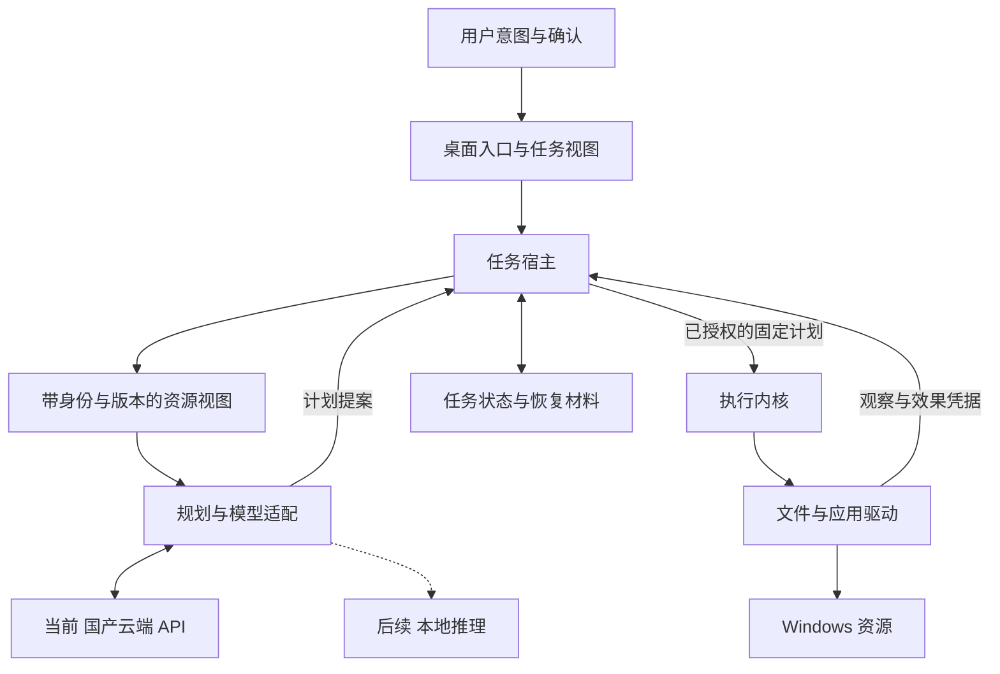

# deskshell 项目方向与设计总览

更新日期：2026-10-31。

deskshell 的长期目标是让个人计算围绕本地模型和智能体组织：用户表达意图，智能体利用电脑完成任务，系统负责资源、权限、执行、验证和恢复。硬件成为本地智能体长期运行的载体。第一阶段交付运行在现有 Windows 电脑上的智能体系统，当前使用国产云端大模型 API 推理，未来切换或扩展为本地推理。

产品方向和研究方向已确认；工程接口仍按 RFC 收敛，研究效果需要实验验证。新的 `agent` CLI 已接入常驻本地宿主，提供 DeepSeek 提案、固定计划、单独批准、照片按月整理与完整内容去重待确认、独立验证、任务历史、跨进程停止及有条件撤销。服务区分任务/控制令牌，并使用跨状态目录的全用户持久日预算。真实 DeepSeek 已在合成编辑器上完成三轮观察与执行；固定记事本计划另已通过真实服务 IPC、应用宿主和原生驱动完整链，CRLF/LF 两次均保存精确副本并保留源文。本地合成规划与真实 DeepSeek 加原生三轮、四类真机故障及默认生产服务也已通过，精确版本/语言的生产配置已放行。旧 CLI/Shell/MCP 迁移、完整桌面产品和研究效果仍未完成。

## 文档入口

| 文件 | 内容 |
| --- | --- |
| [这个项目未来有什么用](docs/zh-CN/why-and-when-to-stop.md) | 价值清算、唯一值得押的楔子、6 周验收与止损条件（迷路时先看这份） |
| [决策记录与待确定事项](docs/zh-CN/decisions.md) | 已确定事项、工程默认、待决问题、何时需要决定 |
| [RFC 0001](rfcs/0001-local-agent-system.md) | 系统分层、任务协议、授权、持久化、恢复和迁移 |
| [RFC 0002](rfcs/0002-semantic-resources-and-effect-receipts.md) | 语义资源视图、效果凭据、选择性恢复和对照实验 |
| [模型后端方案](docs/zh-CN/model-backends.md) | 当前 DeepSeek 云端 API、数据与预算边界、未来本地模型适配 |
| [首个真实应用](docs/zh-CN/first-application.md) | Windows 记事本的选择理由、具体任务与验收边界 |
| [有界自主任务](docs/zh-CN/autonomous-tasks.md) | 固定会话授权、持久轮次、反馈重规划、取消、预算与真实应用限制 |
| [G1 首批实现](docs/zh-CN/task-runtime.md) | 可运行文件任务宿主、固定计划与 SQLite 登记、当前限制和下一批工程 |
| [首个智能体文件任务](docs/zh-CN/agent-file-task.md) | 照片按修改月份整理的自然语言提案、审阅、明确批准、执行验证与停止 |
| [撤销与中断核查](docs/zh-CN/task-recovery.md) | 效果检查点、固定恢复预览、批准、冲突拒绝和进程中断边界 |
| [中文路线图](docs/zh-CN/roadmap.md) / [English roadmap](docs/roadmap.md) | G1–G5 交付顺序、研究原型与工程工作的关系 |
| [当前实现与验证](STATUS.md) | 已有能力、修复证据、真实桌面验证范围 |

本文是项目方向的入口。具体接口以 RFC 为准，待决事项集中维护在决策记录中，已实现能力以代码和验证记录为准。

## 已确认的产品方向

1. **以智能体组织个人计算。** 用户目标是任务入口；文件、应用、窗口和工具成为可管理的资源；系统持续管理任务状态与结果。
2. **当前云端推理，长期面向本地模型。** 当前接入国产云端 API，工程默认选 DeepSeek 官方 API 的 `deepseek-flash`；任务宿主、权限、执行、记录和恢复运行在电脑上。模型后端可替换，不自动更换供应商或扩大数据外发范围。
3. **先在现有 Windows 电脑上交付。** 复用宿主操作系统的进程、设备、文件系统和账户机制。专用设备、自有系统发行版在产品需求与性能经过验证后再决定。
4. **沿用现有工程演进。** 复用 Action v0、Skill、执行内核、驱动、CLI、MCP 和桌面入口，逐步补齐任务运行时。保留已有 macOS/Linux 兼容路径，以 Windows 作为第一阶段产品验收平台。
5. **以完整任务验收。** 真实模型参与理解和规划，任务经过预览、确认、执行、验证、历史和恢复，才能构成第一阶段产品；规则解析和 Mock 回归分别保留其证据范围。

## 系统责任边界

模型理解意图、读取获准的观察、提出技能和参数，必要时追问。可信运行时维护授权、计划、资源状态与执行结果；模型不能自行批准操作或凭文字宣称任务完成。执行内核保持不依赖具体模型。本地读取范围与允许发送给云端的上下文范围分别控制；云端模型只接收必要且获准发送的观察，不持有驱动或宿主凭据。

预览和执行绑定同一份固定计划及其摘要。计划同时约束技能版本、输入、目标、资源、效果和验收条件；关键状态变化后重新准备计划。每个计划只认领一个执行实例，重试返回已有状态。

任务记录持久保存。停止任务先阻止下一步，再核查正在执行的效果；遇到崩溃或超时后无法判断的副作用，明确标为结果未知并等待处理。可精确恢复、可补偿、不可逆分别表达，恢复前检查用户或其他任务的修改。

第一阶段加载审阅过的第一方技能。现有 TypeScript 动态加载是受信代码执行，能力声明不等于第三方沙箱。模型提案、可信审批和实际执行使用不同的权限入口。

详细模块、任务状态、进程边界和迁移规则见 [RFC 0001](rfcs/0001-local-agent-system.md)。

## 已确认的技术研究方向

### 面向任务的语义资源视图

运行时为模型构造有稳定身份、版本、来源和操作约束的电脑资源视图。一个文档在磁盘、应用和窗口中的表示，通过可信证据建立关联。模型基于对象 ID、版本和允许的操作提出请求，运行时负责解析真实对象、检查状态并更新观察。

研究重点是跨表示对象对应、任务相关信息选择、增量更新和过期检测。当前先用同一云端模型做对照，测量任务成功、错误对象操作与 token/调用成本；后续在本地模型上复验。云端结果不能直接证明小型本地模型的收益。

### 效果凭据与选择性恢复

受支持原语由执行端记录实际修改的资源、前后版本、字段或范围、读写依赖及恢复条件。恢复根据这些凭据判断哪些改动仍然可以撤回，保留不冲突的人工修改，对冲突部分报告原因。

例如 Agent 修改结构化文档字段 A 后，用户修改字段 B，恢复 A 时应保留 B；若用户随后也修改 A，则识别冲突。这个能力先在身份和字段语义明确的操作上验证，再扩展到应用驱动。

语义资源视图是主研究方向，效果凭据为其提供可核查的状态变化。相关思想已有先例，研究目标是通过具体机制与公平实验建立贡献，不将“Agent OS”、技能库、数据库或任务持久化本身宣称为首创。相关工作、协议草案、限制及消融实验见 [RFC 0002](rfcs/0002-semantic-resources-and-effect-receipts.md)。

## 当前工程方案

以下是可据此开展原型的工程默认，具体依赖版本和协议字段尚未冻结：

| 项目 | 当前方案 |
| --- | --- |
| 语言与驱动 | TypeScript 负责内核外围与编排，沿用 PowerShell UIA、Swift AX；有明确需求时引入小范围原生组件 |
| 模型后端 | 当前采用 DeepSeek 官方云端 API，默认 `deepseek-flash`；后续评估 Ollama、llama.cpp 等本地适配；服务条款、模型能力和价格按接入时版本核对 |
| 任务宿主 | 新 agent 入口已使用隐藏常驻进程和 loopback IPC，任务/控制通道分离；旧 CLI、Shell、MCP 共用 TaskService 仍是迁移目标 |
| 持久化 | Node 内置 SQLite 保存固定计划、批准、认领、逐步效果和恢复计划；另有全用户日预算账本，JSONL 保留审计与旧日志兼容 |
| 观察 | 优先文件元数据、必要内容与 UIA；截图/OCR 按应用需求补充；读取也受作用域限制 |
| 桌面入口 | 先用现有面板验证任务流程，最终 UI 框架按可访问性、安装和常驻占用选择 |
| 记忆 | 先保存任务历史、明确确认的偏好与有来源的摘要；按实际检索需求再决定向量索引 |
| 工具生态 | MCP server 继续作为开发者入口；第三方 MCP client、插件隔离和设备形态安排在后续阶段 |

## 第一条完整验收任务

用户选择一个目录，要求“把照片按月份整理，重复内容放到待确认目录，保留其它文件”。系统在获准范围内读取，澄清缺项，生成逐文件差异；确认后执行同一计划，重读校验，并提供任务记录与撤销。

当前实现限定根层图像扩展名文件，按修改时间、上海时区归档；显式去重时逐字节确认完整内容相同，将副本移到 `_duplicates` 待确认，保留文件名排序最前的一份以及其他文件、已有子目录。新入口提供固定预览、单独批准、独立目标、历史、跨进程停止、恢复预览及精确恢复批准。普通撤销要求完整目录仍符合已验证状态；人工修改和未知归属保留现场。最新实测见 [STATUS](STATUS.md)，操作见[文件任务说明](docs/zh-CN/agent-file-task.md)。

验收包含同名冲突、人工修改、写入失败、取消和进程中断。Windows 记事本固定任务已在 `11.2607.14.0` 的专用合成窗口完成打开、中文标题修改与追加、另存及独立重读，三个原生阶段均验证；UTF-8 无 BOM 的 CRLF/LF、空行、中文路径、源文保持和仅新增指定副本分别核对。早期人工输入拒绝另计；后续真实 DeepSeek 加原生三轮成功，2,543 token、估算 0.0038316 USD（非账单），四类故障保留现场且未改源文。默认生产服务通过，选择器只接受已放行的精确版本与 `zh-CN`，每宿主生命周期仅执行一个文档任务，后续须重启并准备新计划，不自动关闭用户窗口。详见[应用验收方案](docs/zh-CN/first-application.md)。

研究原型先限定文件、结构化文档和受控 UI。所有对照组使用相同供应商与模型配置、底层操作能力、授权范围和预算，独立记录目标成功、拒绝、误操作、推理消耗与恢复结果。客户端硬件保持一致，云端计算硬件不可由本项目控制；本地模型复验时再固定推理硬件。

## 交付顺序

| 阶段 | 交付重点 |
| --- | --- |
| G1 | 最小任务宿主、固定计划、可信批准、持久执行认领、统一入口 |
| G2 | 步骤记录、备份、资源冲突控制、停止与崩溃后的核查恢复 |
| G3 | 真实云端模型 API、观察和规划循环、目标验证、追问与调用预算 |
| G4 | 常驻桌面体验、真实应用验证、外部用户独立完成任务 |
| G5 | 第三方扩展隔离、MCP client、更多平台与设备形态 |

G1–G4 共同构成第一阶段用户产品。研究原型随工程并行推进：G1 可开展只读语义视图实验；模型触发写入必须接入固定计划和授权链路；效果凭据与 G2 的步骤恢复协同，G3 验证真实模型收益。研究结果决定哪些机制进入产品默认路径。

首批工程变更依次为：统一 TaskService 与完整 TaskResult；持久固定计划；宿主批准与执行认领；保存计划的执行、失效和取消；CLI、Shell、MCP 迁移及兼容验收。阶段是验收顺序，尚无承诺日期。

## 已完成的修复与证据

本轮已修复空能力声明绕过检查、缺失撤销时的执行与恢复记账、嵌套文件写入的隐式目录残留，以及 MCP 的平台驱动与技能上下文接入，并增加相关回归。

2026-10-31 的既有验证记录为：无桌面回归 52/52 通过、4 项桌面检查跳过；文件恢复基准覆盖 17 次后置断言失败注入，正常路径撤销 5/5。MCP 桌面集成使用 MockDriver。具体结果与边界见 [STATUS](STATUS.md)，不将这些结果用于证明新任务系统或两项研究机制已经实现。

## 下一步需要收敛的事项

文件服务、受限照片组合、日预算、有条件恢复、固定授权多轮和固定原生应用链已有实现。下一批扩展原生扰动与支持矩阵，继续推进旧三入口迁移、追问与自由重规划、质量门槛、恢复材料配额和外部试用。当前完整快照恢复不是选择性恢复的研究结论；本地模型最低硬件仍后置。详见[文件任务](docs/zh-CN/agent-file-task.md)、[运行时](docs/zh-CN/task-runtime.md)、[恢复边界](docs/zh-CN/task-recovery.md)和[决策记录](docs/zh-CN/decisions.md)。
