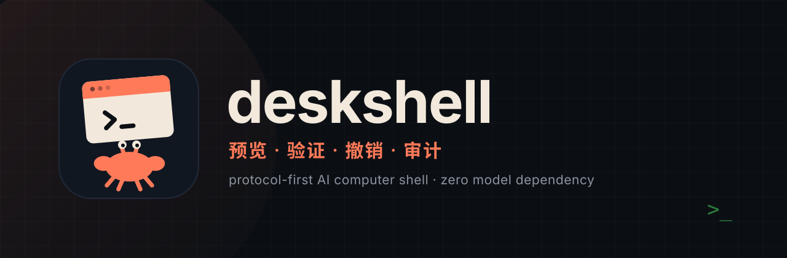
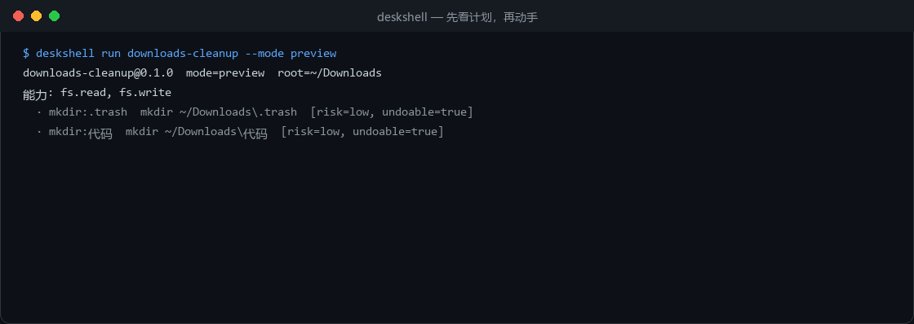
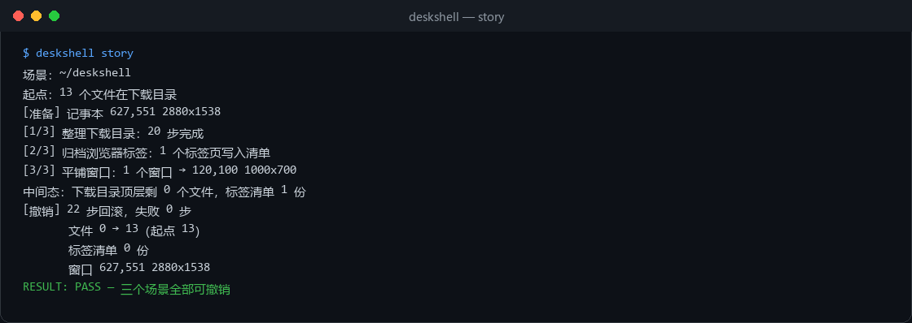
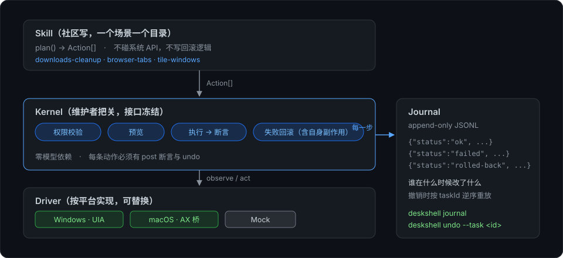

<p align="center">
  
</p>

<p align="center">
  <b>AI can drive your computer — but every action should be previewed, verified, undoable, and auditable.</b><br>
  Not "a script that clicks things": a protocol-first kernel with transactional semantics.
</p>

<p align="center">
  <a href="https://github.com/ciceroyang/deskshell/actions/workflows/ci.yml"></a>
  
  
  
</p>

<p align="center">
  <b>English</b> · <a href="README.zh-CN.md">简体中文</a>
</p>

## How it differs

| | Typical agent / automation script | deskshell |
| --- | --- | --- |
| Before acting | Just does it — you don't know what will happen | `preview` shows the plan, risk level, and whether each step is undoable |
| After acting | "It probably worked" | Every step runs a post-assertion; failure stops the run |
| On failure | Leaves a half-modified mess | Undoes the failing action's own side effects, then rolls back everything else in reverse |
| Afterwards | Nobody knows what happened | JSONL journal: who, when, what changed, how to undo |
| Model | Locked to one vendor | **Zero model dependency in the kernel** — a swappable part inside skills |

## What it looks like



<sub>Rendered from real command output (`scripts/make-assets.py`), not a mockup.</sub>

Three scenarios, one undo — file moves, a UI-driven export, and window geometry all inside the same transaction:



```
[undo] 22 steps rolled back, 0 failures
       files 0 → 13 (started at 13)
       tab index 0 files
       window 627,551 2880x1538      ← restored pixel-for-pixel
```

## Architecture



- **Skill** — declares intent only (`plan() → Action[]`). No system APIs, no rollback code.
- **Kernel** — permissions, preview, execution, assertions, rollback, journal. The part with a frozen interface.
- **Driver** — platform-specific (Windows UIA / macOS AX / Mock), fully replaceable.

## Install

Requires Node **>=22.18** (or >=23.6) — the CLI runs TypeScript directly, and type stripping is only unflagged from those versions.

**From a release tarball** (no registry, no auth):

```bash
npm i -g https://github.com/ciceroyang/deskshell/releases/download/v0.2.0/ciceroyang-deskshell-0.2.0.tgz
deskshell doctor
```

**From GitHub Packages** (needs a GitHub token with `read:packages`):

```bash
npm config set @ciceroyang:registry https://npm.pkg.github.com
npm i -g @ciceroyang/deskshell
```

**From source:**

```bash
git clone https://github.com/ciceroyang/deskshell && cd deskshell
node bin/deskshell.ts doctor
```

> npmjs.com is unreachable from some networks (the registry API works, the website returns 403). Until that is resolved, the two channels above are the supported install paths; `npm i -g deskshell` will follow once the public registry publish goes through.

## Quick start

```bash
node bin/deskshell.ts doctor                        # environment self-check
node scripts/make-fixture.ts                        # create a 13-file downloads folder
node bin/deskshell.ts run downloads-cleanup --root .demo/downloads              # preview only
node bin/deskshell.ts run downloads-cleanup --root .demo/downloads --mode apply
node bin/deskshell.ts run downloads-cleanup --root .demo/downloads --mode undo
```

No API key. No network. No model.

Watch a failure roll back:

```bash
node bin/deskshell.ts story --fail
```

## Commands

| Command | Purpose |
| --- | --- |
| `deskshell list` | List installed skills |
| `deskshell run <name>` | Preview / apply / undo (preview is the default) |
| `deskshell story` | Run three scenarios and undo them all |
| `deskshell journal` | Render the audit trail |
| `deskshell undo --task <id>` | Undo one specific task (idempotent) |
| `deskshell add <path>` | Install an external skill (prints requested capabilities first) |
| `deskshell verify` | Check driver capabilities on this platform |
| `deskshell doctor` | Environment self-check |
| `deskshell version` | Version info |

## Platforms

| Platform | Status | Verify with |
| --- | --- | --- |
| Windows | Verified (UI Automation) | `deskshell doctor` |
| macOS | Verified (native Swift AX bridge, 20 windows in 36 ms) | `deskshell doctor` |
| Linux | Planned (AT-SPI2) | — |

macOS requires building the bridge first: `packages/drivers/macos/build.sh` (Xcode Command Line Tools), plus granting Terminal accessibility permission.

## Write a skill

```bash
node scripts/new-skill.ts --name my-skill
node bin/deskshell.ts run my-skill --mode preview
```

Three hard rules: every action needs a `post` assertion; every action needs an `undo`; skills never call system APIs directly.

## Learn more

- [STATUS.md](STATUS.md) — every capability paired with a reproducible command and its actual output
- [CHANGELOG.md](CHANGELOG.md) — 0.1.0 scope and known limits
- [docs/](docs/) — protocol, skills, undo semantics, recorder, drivers, versioning, roadmap (**English**; 中文在 [docs/zh-CN](docs/zh-CN/))
- `node scripts/build-docs.ts` → `site/index.html` for a local docs site

## Known limits

- **No Linux driver** yet; file-based skills are unaffected.
- **Recorder polls at 300 ms**, may miss fast switches; left clicks only.
- **Undo covers file and window-geometry changes**; external side effects (network calls) are not undoable — the protocol rejects actions with `undo: null`.
- Pre-1.0: breaking changes go through an RFC and ship with migration notes in the CHANGELOG.

## Design invariants

1. Skills never call system APIs; they only produce `Action`s.
2. Every `Action` must declare a `post` assertion; non-undoable actions must be marked and will be rejected.
3. Capabilities must be declared, justified in plain language, and scoped.
4. The kernel has no model dependency; models may only live behind two replaceable interfaces: perceive and plan.

MIT License.
