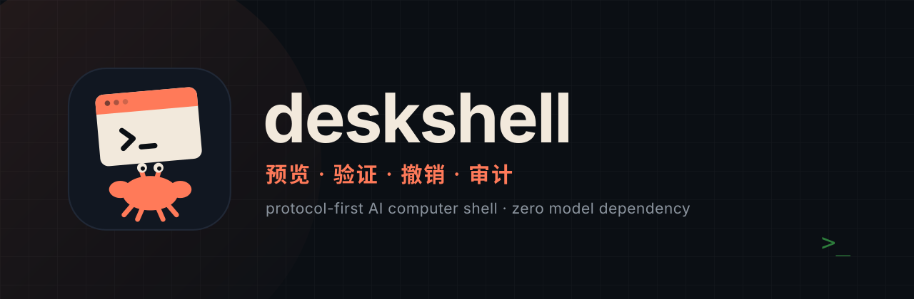
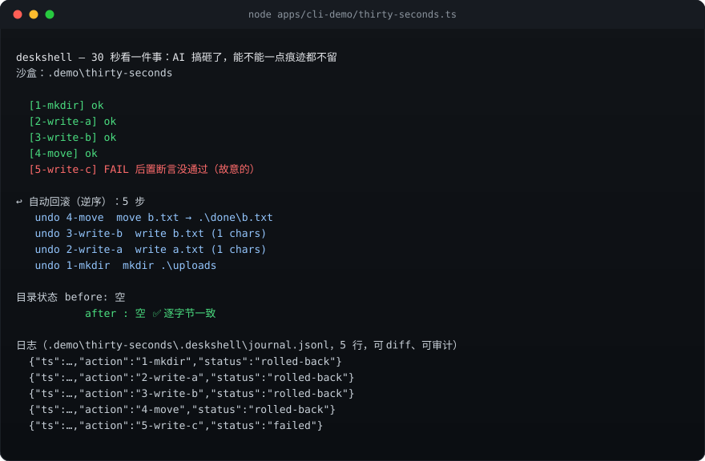
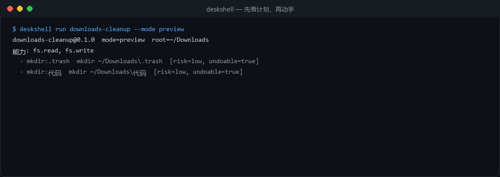
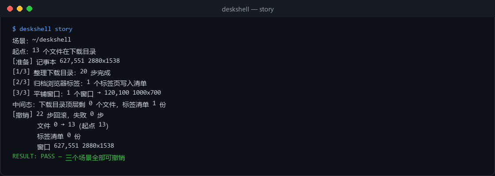
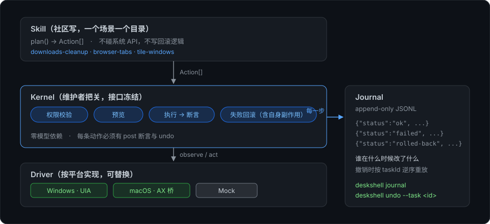

<p align="center">
  
</p>

<p align="center">
  <b>Let AI actually finish the work inside your files — and put it back when it goes wrong.</b><br>
  Every action is a declared contract: asserted, undoable, auditable. <code>deskshell relay</code> is the first everyday use of it.
</p>

<p align="center">
  <a href="https://github.com/ZhiliangTech/deskshell/actions/workflows/ci.yml"></a>
  
  
  
</p>

<p align="center">
  <b>English</b> · <a href="README.zh-CN.md">简体中文</a>
</p>

## 30 seconds: it breaks, and nothing is left behind



<sub>Rendered from the command's real output (`scripts/make-terminal-svg.ts`) — regenerate it and it changes with the code.</sub>


```bash
node apps/cli-demo/thirty-seconds.ts
```

Five steps run against a sandbox. The fourth succeeds, the **fifth fails**, and everything undoes itself:

```
  [1-mkdir]     ok
  [2-write-a]   ok
  [3-write-b]   ok
  [4-move]      ok
  [5-write-c]   FAIL 后置断言失败：{"kind":"path.exists","path":".../this-will-never-exist"}

↩ auto-rollback (reverse order): 5 处
   undo 4-move      move b.txt → .../done/b.txt
   undo 3-write-b   write b.txt (1 chars)
   undo 2-write-a   write a.txt (1 chars)
   undo 1-mkdir     mkdir .../uploads

目录状态   before: 空
           after : 空   ✅ 逐字节一致

日志（.deskshell/journal.jsonl，5 行）
  {"ts":...,"action":"1-mkdir","status":"rolled-back"}
  …
  {"ts":...,"action":"5-write-c","status":"failed"}
```

That last line matters: **the step that failed is in the journal too**. A run that fails is still a run you can audit.

The claim is a test, not a promise — `scripts/thirty-seconds-test.ts` fails the build if the exit code is non-zero, if the journal is not exactly 5 lines, or if the directory is not byte-identical afterwards.

## Try the relay: the work lands in your file, and comes back out

```bash
deskshell relay --from note.md --to note.md        # rewrite in place
deskshell relay --from note.md --to draft.md --dry-run   # manifest only: nothing sent, nothing written
deskshell undo --last --root .                     # put it back, byte for byte
```

It does four things: take the material → print a **send manifest** (who gets it, how many bytes, which digest, no absolute paths) → write the result **back into the real file** (through the kernel, so it is undoable) → record it in the journal.

> **The backend is a stub today**: `stubBackend()` is a deterministic echo, so what lands in the file is
> your text plus a `[stub]` marker. What this command proves right now is the pipeline —
> manifest → write-back → byte-exact undo → journal — not that a model wrote something good. The seam for a
> real model is `packages/models/src/deepseek.ts`, which needs a `complete()` bounded the same way as
> `propose()`; there is deliberately no `--backend deepseek` until that exists.

The difference from a selection-popup is structural, not cosmetic: a bubble gives you a paragraph; this gives you **a file you can undo** and **a ledger you can check**. See [relay notes](docs/zh-CN/relay-spec.md).

## R0 — the number nobody else reports

Every computer-use project publishes a success rate. None publish what a failure leaves behind.

```
node scripts/recovery-bench.ts
```

```
R0-残渣     100.0%（17 次失败注入）
R0-回滚     100.0%
R0-可追溯   100.0%
正常路径撤销后逐字节还原：5/5
```

| Surface | What is measured | Now |
| --- | --- | --- |
| **Files** | byte-identical restore, completed steps undone, journal presence | **100% / 100% / 100%** (17 injected failures) |
| **UI** | window geometry, control values, and *refusing* irreversible steps | **100%** (5 injected failures) |

The UI number only reads 100% because "refused before touching anything" counts as zero residue — see [docs/recovery.md](docs/recovery.md).

**R0 = recovery rate at zero residue**: inject a failing post-assertion at every step of five filesystem scenarios, then compare the directory byte for byte, check the completed-step rollback count, and check that a journal exists. These results describe the current fixtures, including writes that create their own parent directories; they do not cover every possible execution or recovery failure. Definitions and extension guidance: [docs/recovery.md](docs/recovery.md).

## Call it from your agent (MCP)

The kernel is also an MCP server, so an agent can plan, act, and take it back instead of guessing:

```bash
node packages/mcp/server.ts     # stdio JSON-RPC: initialize / tools/list / tools/call
```

| Tool | What it does |
| --- | --- |
| `deskshell_skills` | list installed skills |
| `deskshell_preview` | read-only: capability sheet + steps + summary |
| `deskshell_apply` | run it, returns `taskId` |
| `deskshell_undo` | roll back that `taskId` |

No SDK, no dependencies. `scripts/mcp-test.ts` spawns the server and talks to it like a client would (14/14). Details: [docs/mcp.md](docs/mcp.md).

## What it is (and is not)

| | |
| --- | --- |
| **Is** | the runtime an agent calls to act on a machine: capability → action → post-assertion → undo → journal |
| **Is not** | an agent, a chat UI, an RPA recorder, or a wrapper around a model API |
| **Why it exists** | an agent that "just clicks" cannot tell you whether the click worked, and cannot take it back |

## Proof (run it yourself)

```bash
node scripts/recovery-bench.ts
```

```
R0-residue     100.0%   (17 failure injections)
R0-rollback    100.0%
R0-traceable   100.0%
happy-path undo restores byte-for-byte: 5/5
```

Every computer-use project reports a success rate. This is the other number: what a failure leaves behind.

## How it differs

| | Typical agent / automation script | deskshell |
| --- | --- | --- |
| Before acting | Just does it — you don't know what will happen | `preview` shows the plan, risk level, and whether each step is undoable |
| After acting | "It probably worked" | Checks supplied post-assertions; failure stops the run |
| On failure | Leaves a half-modified mess | Attempts self-undo and reverse rollback; reports any incomplete recovery |
| Afterwards | Nobody knows what happened | JSONL journal: who, when, what changed, how to undo |
| Model | Locked to one vendor | **Zero model dependency in the kernel** — a swappable part inside skills |

## What it looks like



<sub>Rendered from real command output (`scripts/make-assets.py`), not a mockup.</sub>

Three scenarios, one undo — file moves, a UI-driven export, and window geometry all inside the same transaction:



```
[undo] 22 steps rolled back, 0 failures
       files 0 → 13 (started at 13)
       tab index 0 files
       window 627,551 2880x1538      ← restored pixel-for-pixel
```

## Architecture



- **Skill** — declares intent only (`plan() → Action[]`). No system APIs, no rollback code.
- **Kernel** — permissions, preview, execution, assertions, rollback, journal. The part with a frozen interface.
- **Driver** — platform-specific (Windows UIA / macOS AX / Mock), fully replaceable.

## Install

Requires Node **>=22.18** (or >=23.6) — the CLI runs TypeScript directly.

**Installer** (works where `github.com` is blocked; it downloads through the GitHub API):

```powershell
irm https://raw.githubusercontent.com/ZhiliangTech/deskshell/main/install.ps1 -OutFile install.ps1
.\install.ps1
```

It checks Node/npm, fetches the latest release asset, installs it, and runs `deskshell doctor` for you.

**GitHub Packages** (needs a token with `read:packages`):

```bash
npm config set @zhiliangtech:registry https://npm.pkg.github.com
npm i -g @zhiliangtech/deskshell
```

**From source:**

```bash
git clone https://github.com/ZhiliangTech/deskshell && cd deskshell
node bin/deskshell.ts doctor
```

> The npm **website** is blocked on some networks while the registry API stays fine — which is why the installer goes through the API. The public npm package **works**: `npm i -g @zhiliangtech/deskshell` installs 0.18.7 (`latest`, measured 2026-10-31). GitHub Packages (`@zhiliangtech/deskshell`) and `npm i -g github:ZhiliangTech/deskshell` stay available as fallbacks.

## Quick start

```bash
node bin/deskshell.ts doctor                        # environment self-check
node scripts/make-fixture.ts                        # create a 13-file downloads folder
node bin/deskshell.ts run downloads-cleanup --root .demo/downloads              # preview only
node bin/deskshell.ts run downloads-cleanup --root .demo/downloads --mode apply
node bin/deskshell.ts run downloads-cleanup --root .demo/downloads --mode undo
```

No API key. No network. No model.

Watch a failure roll back:

```bash
node bin/deskshell.ts story --fail
```

## Commands

| Command | Purpose |
| --- | --- |
| `deskshell list` | List installed skills |
| `deskshell run <name>` | Preview / apply / undo (preview is the default) |
| `deskshell story` | Run three scenarios and undo them all |
| `deskshell journal` | Render the audit trail |
| `deskshell undo --task <id>` | Undo one specific task (idempotent) |
| `deskshell add <path>` | Install an external skill (prints requested capabilities first) |
| `deskshell verify` | Check driver capabilities on this platform |
| `deskshell doctor` | Environment self-check |
| `deskshell version` | Version info |

## Platforms

| Platform | Status | Verify with |
| --- | --- | --- |
| Windows | Verified (UI Automation) | `deskshell doctor` |
| macOS | Verified (native Swift AX bridge, 20 windows in 36 ms) | `deskshell doctor` |
| Linux | Window-level implemented (xdotool + wmctrl); control-level (selector) still AT-SPI2 | `deskshell verify` |

macOS requires building the bridge first: `packages/drivers/macos/build.sh` (Xcode Command Line Tools), plus granting Terminal accessibility permission.

## Write a skill

```bash
node scripts/new-skill.ts --name my-skill
node bin/deskshell.ts run my-skill --mode preview
```

Authoring guidelines: provide a `post` assertion for every action, provide an `undo` for reversible actions, and route mutations through the kernel. Protocol v0 keeps `post` optional; missing/null `undo` requires explicit confirmation before apply. `fs.delete` without an undo is always rejected.

## Learn more

- [STATUS.md](STATUS.md) — every capability paired with a reproducible command and its actual output
- [CHANGELOG.md](CHANGELOG.md) — 0.1.0 scope and known limits
- [Project direction and design](PROJECT.md) — agreed product and research directions, engineering roadmap, and open decisions (Chinese).
- [docs/](docs/) — protocol, skills, undo semantics, recorder, drivers, versioning, roadmap (**English**; 中文在 [docs/zh-CN](docs/zh-CN/))
- `node scripts/build-docs.ts` → `site/index.html` for a local docs site

## Progress

`WORKLOG.md` tracks engaged hours against a 480-hour plan split into 12 verifiable milestones (from "a stranger can run it" to "the first real user"). It is generated by `node scripts/clock.ts --write`, not typed by hand.

## Known limits

- **Linux has no accessibility tree yet**: the window-level driver (xdotool + wmctrl) works, but selector-level `invoke`/`click` reports unsupported instead of pretending to click.
- **Recorder polls at 300 ms**, may miss fast switches; left clicks only.
- **Undo covers supported file and UI changes**; missing/null `undo` or `irreversible: true` requires explicit confirmation, and confirmed irreversible effects cannot be recovered. `fs.delete` without an undo remains prohibited.
- Pre-1.0: breaking changes go through an RFC and ship with migration notes in the CHANGELOG.

## Design invariants

1. Skills never call system APIs; they only produce `Action`s.
2. Authors should provide a `post` assertion for each action; v0 validates supplied assertions. Non-undoable actions require explicit confirmation before execution, subject to stricter policies such as the deletion rule above.
3. Capabilities must be declared, justified in plain language, and scoped.
4. The kernel has no model dependency; models may only live behind two replaceable interfaces: perceive and plan.

## Docs

Read the protocol, quick start and design invariants as a site: <https://zhiliangtech.github.io/deskshell/>.

## Build it with us

deskshell is a protocol first, a product second — and the hard parts are still unowned:

| Open surface | Where to start |
| --- | --- |
| **Linux control layer** (AT-SPI2) | the window-level driver already ships; add the accessibility-tree backend so selector-level `click`/`invoke` work |
| **Recorder event hooks** (drop the 300 ms polling) | `packages/drivers/windows/recorder.ps1` |
| Dry-run diffs · undo timeline · docs search | scoped issues, kernel + docs site |
| **New skills** | `node scripts/new-skill.ts --name x`, then only `plan()` |

Every task ships with a fixture, a failing test, and a 48-hour first response. Bounty board, contributor ladder, governance and the outreach playbook live in [`outreach/`](outreach/). Merged work lands in [CONTRIBUTORS.md](CONTRIBUTORS.md). Questions and roadmap votes happen in [Discussions](https://github.com/ZhiliangTech/deskshell/discussions).

MIT License.
