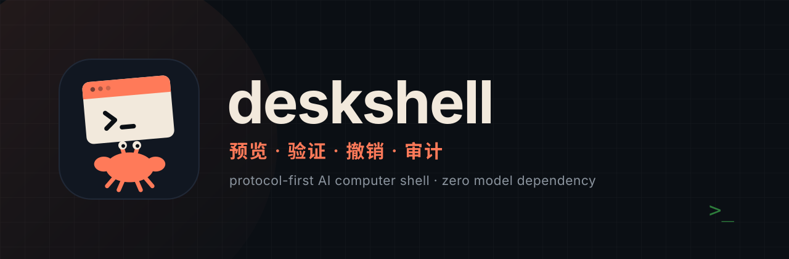
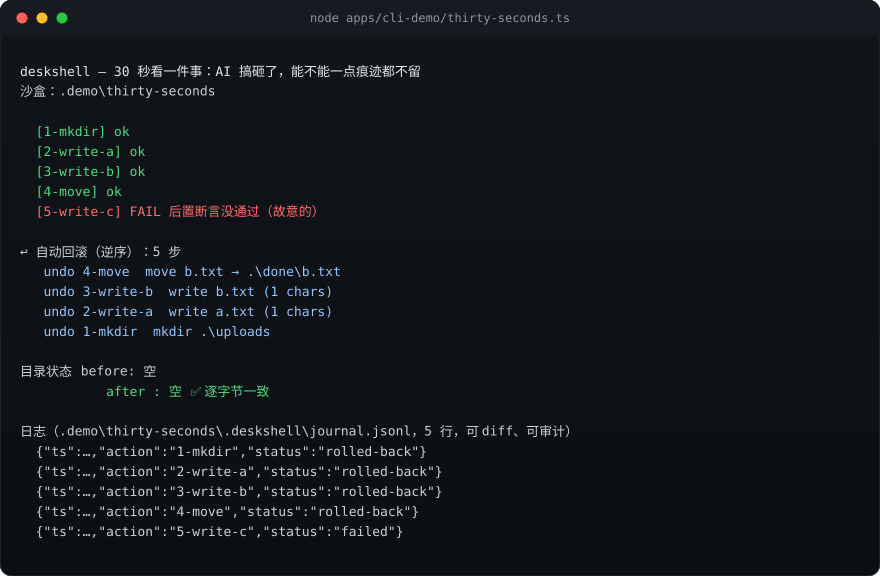
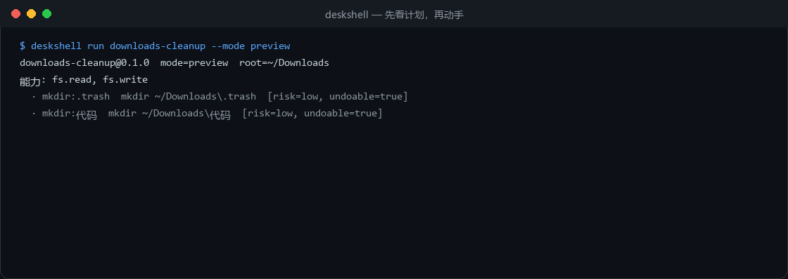
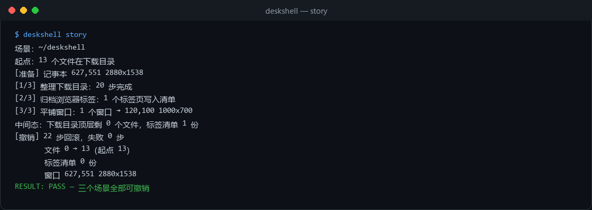
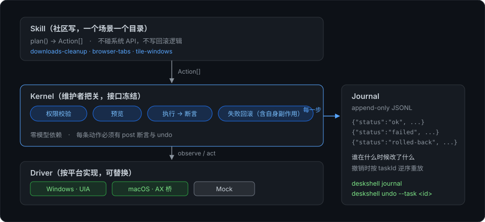

<p align="center">
  
</p>

<p align="center">
  <b>让 AI 的活真的落到你的文件里——做错了，一键退回原样。</b><br>
  每个动作都是一份合同：可声明、可断言、可撤销、可审计。<code>deskshell relay</code> 是它第一个面向普通人的用法。
</p>

<p align="center">
  <a href="https://github.com/ZhiliangTech/deskshell/actions/workflows/ci.yml"></a>
  
  
  
</p>

<p align="center">
  <a href="README.md">English</a> · <b>简体中文</b>
</p>

## 30 秒：它搞砸了，而且一点痕迹都不留



<sub>这张图是用命令的真实输出渲染的（`scripts/make-terminal-svg.ts`）——重跑一次，它就跟着代码变。</sub>


```bash
node apps/cli-demo/thirty-seconds.ts
```

五步跑在一个沙盒里。第四步成功，**第五步失败**，然后全部自动退回：

```
  [1-mkdir]     ok
  [2-write-a]   ok
  [3-write-b]   ok
  [4-move]      ok
  [5-write-c]   FAIL 后置断言失败：{"kind":"path.exists","path":".../this-will-never-exist"}

↩ 自动回滚（逆序）：5 处
   undo 4-move      move b.txt → .../done/b.txt
   undo 3-write-b   write b.txt (1 chars)
   undo 2-write-a   write a.txt (1 chars)
   undo 1-mkdir     mkdir .../uploads

目录状态   before: 空
           after : 空   ✅ 逐字节一致
```

注意最后那条日志：**失败的那一步也在日志里**。失败的任务仍然是可审计的任务。

这不是承诺，是测试——`scripts/thirty-seconds-test.ts` 会在三种情况下让构建失败：退出码非零、日志不是正好 5 行、目录没有逐字节还原。

## 试一下 relay：AI 的活落到文件里，还能退回

```bash
deskshell relay --from note.md --to note.md        # 原地改写
deskshell relay --from note.md --to draft.md --dry-run   # 只出外发清单，不发、不写
deskshell undo --last --root .                     # 退回上一步，逐字节还原
```

它只做四件事：拿材料 → 出**外发清单**（发给谁、多少字节、摘要；清单里不出现任何绝对路径）→ 把结果**写回真实文件**（走内核，所以可撤销）→ 进账本。

> **当前后端是占位实现**：`stubBackend()` 是确定性回显，写回的内容会是原文加一段 `[stub]`。
> 这条命令现在证明的是"外发清单 → 写回 → 逐字节撤销 → 进账本"这条管线，不是"AI 改得对"。
> 真模型接缝在 `packages/models/src/deepseek.ts`，需要一个与 `propose()` 同等有界的 `complete()`；
> 没接上之前不提供 `--backend deepseek`，免得看起来能用其实不通。

和"划词问答"的差别不在交互，在结构：气泡给你一段话，这里给你**一个能撤回的文件**加一份**能查的账**。见 [relay 说明](docs/zh-CN/relay-spec.md)。

## R0 —— 别人不报的那个数

所有 computer-use 项目都报成功率，没有人报"失败之后留下了什么"。

```
node scripts/recovery-bench.ts
```

```
R0-残渣     100.0%（17 次失败注入）
R0-回滚     100.0%
R0-可追溯   100.0%
正常路径撤销后逐字节还原：5/5
```

| 面 | 量的是什么 | 现在 |
| --- | --- | --- |
| **文件** | 逐字节还原、已完成步骤撤销、日志存在性 | **100% / 100% / 100%**（17 次失败注入） |
| **UI** | 窗口几何、控件值，以及**拦住**不可逆步骤 | **100%**（5 次失败注入） |

UI 那个 100% 之所以成立，是因为"动手前就拒绝"也算零残渣——判据见 [docs/zh-CN/recovery.md](docs/zh-CN/recovery.md)。

**R0 = 失败后副作用归零率**：在五个文件场景的每一步注入后置断言失败，然后逐字节比对目录、核对已完成步骤的撤销数，并检查日志是否存在。结果仅代表当前夹具，包括写入时自动创建父目录的场景，不覆盖所有执行或恢复失败。定义与"如何加场景"见 [docs/zh-CN/recovery.md](docs/zh-CN/recovery.md)。

## 从你的 agent 里调用（MCP）

内核同时是一个 MCP server：agent 可以"先看计划 → 执行 → 需要时撤回"，而不是凭感觉点鼠标。

```bash
node packages/mcp/server.ts     # stdio JSON-RPC：initialize / tools/list / tools/call
```

| 工具 | 作用 |
| --- | --- |
| `deskshell_skills` | 列出已安装技能 |
| `deskshell_preview` | 只读：能力申请单 + 步骤 + 汇总 |
| `deskshell_apply` | 执行，返回 `taskId` |
| `deskshell_undo` | 撤销那个 `taskId` |

不引 SDK、不引依赖。`scripts/mcp-test.ts` 会真的起进程按客户端方式对话（14/14）。详见 [docs/zh-CN/mcp.md](docs/zh-CN/mcp.md)。

## 它是什么，不是什么

| | |
| --- | --- |
| **是** | agent 操作机器时调用的那层运行时：能力 → 动作 → 后置断言 → 撤销 → 审计日志 |
| **不是** | 一个 agent、一个聊天界面、一个 RPA 录制器，或一层模型 API 的包装 |
| **为什么需要它** | "只会点鼠标"的 agent 既不知道点没点中，也没法把点到的东西还回去 |

## 证明（你自己跑）

```bash
node scripts/recovery-bench.ts
```

```
R0-残渣     100.0%（17 次失败注入）
R0-回滚     100.0%
R0-可追溯   100.0%
正常路径撤销后逐字节还原：5/5
```

所有 computer-use 项目都在报成功率。这是另一个数：**失败之后留下了什么。**

## 它和别的方案的区别

| | 普通 agent / 自动化脚本 | deskshell |
| --- | --- | --- |
| 动手前 | 直接开干，你不知道它会做什么 | `preview` 先给计划，标出风险与是否可撤销 |
| 动手后 | "应该成功了吧" | 执行后检查已提供的断言，失败即停 |
| 出错时 | 留下半个烂摊子 | 尝试自撤和逆序回滚，如实报告恢复不完整 |
| 事后 | 没人知道发生了什么 | JSONL 审计：谁、何时、改了什么、怎么撤 |
| 模型 | 绑死某个厂商 | **内核零模型依赖**，模型只是 skill 内部的可替换件 |

## 实际跑起来是这样



<sub>动图由真实命令输出生成（`scripts/make-assets.py`），不是手绘示意图。</sub>

三个场景，一次撤销——文件移动、UI 写入、窗口几何走同一个事务：



```
[撤销] 22 步回滚，失败 0 步
       文件 0 → 13（起点 13）
       标签清单 0 份
       窗口 627,551 2880x1538      ← 逐像素还原
```

## 架构



- **Skill** 只描述意图（`plan() → Action[]`），不碰系统 API、不写回滚逻辑；
- **Kernel** 负责权限、预览、执行、断言、回滚、审计——接口冻结的那一层；
- **Driver** 按平台实现（Windows UIA / macOS AX / Mock），可整体替换。

## 安装

需要 Node **>=22.18**（或 >=23.6）——CLI 直接运行 TypeScript。

**安装脚本**（`github.com` 打不开的网络也能用，它走 GitHub API 下载）：

```powershell
irm https://raw.githubusercontent.com/ZhiliangTech/deskshell/main/install.ps1 -OutFile install.ps1
.\install.ps1
```

它会检查 Node/npm、拉最新发行版、安装、然后自动跑 `deskshell doctor`。

**GitHub Packages**（需要带 `read:packages` 的 token）：

```bash
npm config set @zhiliangtech:registry https://npm.pkg.github.com
npm i -g @zhiliangtech/deskshell
```

**从源码：**

```bash
git clone https://github.com/ZhiliangTech/deskshell && cd deskshell
node bin/deskshell.ts doctor
```

> 部分网络打不开 npmjs.com 的**网页**，但 registry API 是通的——安装脚本因此走 API 下载。公共 npm 上的 `@zhiliangtech/deskshell` **实测 `latest=0.18.7`**，`npm i -g @zhiliangtech/deskshell` 直接可用。也可以走安装脚本、GitHub Packages，或从 Git 装：`npm i -g github:ZhiliangTech/deskshell`。

## 30 秒装好跑通

```bash
node bin/deskshell.ts doctor                        # 环境自检
node scripts/make-fixture.ts                        # 造 13 个文件的下载目录
node bin/deskshell.ts run downloads-cleanup --root .demo/downloads              # 只预览，不动手
node bin/deskshell.ts run downloads-cleanup --root .demo/downloads --mode apply
node bin/deskshell.ts run downloads-cleanup --root .demo/downloads --mode undo
```

不需要 API key，不需要联网，不需要模型。

想亲眼看失败回滚：

```bash
node bin/deskshell.ts story --fail
```

## 命令

| 命令 | 用途 |
| --- | --- |
| `deskshell list` | 列出可用 skill |
| `deskshell run <name>` | 预览 / 执行 / 撤销（默认预览） |
| `deskshell story` | 三场景跑一遍并整体撤销 |
| `deskshell journal` | 审计日志时间线 |
| `deskshell undo --task <id>` | 撤销某一次任务（幂等） |
| `deskshell add <path>` | 安装外部 skill（先打印它要的能力） |
| `deskshell verify` | 检查平台驱动能力 |
| `deskshell doctor` | 环境自检 |
| `deskshell version` | 版本信息 |

## 平台

| 平台 | 状态 | 验证方式 |
| --- | --- | --- |
| Windows | 已验证（UI Automation） | `deskshell doctor` |
| macOS | 已验证（原生 Swift AX 桥，20 个窗口 36ms） | `deskshell doctor` |
| Linux | 窗口层已实现（xdotool + wmctrl）；控件层（selector）待 AT-SPI2 | `deskshell verify` |

macOS 需要先编译桥：`packages/drivers/macos/build.sh`（Xcode Command Line Tools），并在「系统设置 → 隐私与安全性 → 辅助功能」给终端授权。

## 写一个 skill

```bash
node scripts/new-skill.ts --name my-skill
node bin/deskshell.ts run my-skill --mode preview
```

编写准则：为每步提供 `post` 断言，为可逆动作提供 `undo`，所有修改交给内核执行。协议 v0 中 `post` 仍可选；缺失/null `undo` 需要在执行前显式确认。`fs.delete` 缺少撤销动作时始终被拒绝。

## 更多

- [STATUS.md](STATUS.md)：每条能力配一条可复现命令与实测输出
- [CHANGELOG.md](CHANGELOG.md)：0.1.0 归档与已知限制
- [项目方向与设计总览](PROJECT.md)：已确认的本地智能体产品方向、技术研究、工程路线与待确定事项。
- [docs/](docs/)：协议、写 skill、撤销语义、录制器、驱动、版本策略、路线图（**英文**；中文在 [docs/zh-CN](docs/zh-CN/)）
- `node scripts/build-docs.ts` → `site/index.html`（本地文档站）

## 已知限制

- **Linux 还没有可访问性树**：窗口层驱动（xdotool + wmctrl）可用，但 selector 级的 `invoke`/`click` 会明确报不支持，不会假装点成功。
- **录制器是 300ms 轮询**，快速切换可能漏采；只捕获左键。
- **撤销覆盖受支持的文件与 UI 改动**；缺失/null `undo` 或 `irreversible: true` 需要显式确认，已确认的不可逆影响无法恢复。`fs.delete` 缺少撤销动作仍被禁止。
- 项目处于 `0.x`，破坏性变更走 RFC 并在 CHANGELOG 给迁移说明。

## 设计红线

1. skill 不准直接调用系统 API，只能产出 `Action`。
2. 编写动作时建议逐步提供 `post` 断言，v0 校验已提供的断言；不可撤销动作必须在执行前显式确认，并遵守上述删除规则等更严格策略。
3. 能力必须声明、必须带人话理由、必须落在作用域内。
4. 内核不依赖任何模型；模型只允许出现在"理解屏幕"和"拆解任务"两个可替换接口后面。

## 文档站

协议、快速开始、设计红线都有网页版：<https://zhiliangtech.github.io/deskshell/>。

## 一起把它做出来

deskshell 先是协议，其次才是产品——最硬的部分还没人认领：

| 待认领 | 从哪里下手 |
| --- | --- |
| **Linux 控件层**（AT-SPI2） | 窗口层驱动已有；补可访问性树后端，让 selector 级 `click`/`invoke` 可用 |
| **录制器事件钩子**（干掉 300ms 轮询） | `packages/drivers/windows/recorder.ps1` |
| dry-run diff · 撤销时间线 · 文档站搜索 | 已拆成带验收标准的 issue |
| **新 skill** | `node scripts/new-skill.ts --name x`，然后只改 `plan()` |

每个任务都自带 fixture、一个会失败的测试，和 48 小时内的首次响应。任务板、贡献者阶梯、治理与拉人手册在 [`outreach/`](outreach/)，已合并的贡献记在 [CONTRIBUTORS.md](CONTRIBUTORS.md)；提问和路线图投票在 [Discussions](https://github.com/ZhiliangTech/deskshell/discussions)。注意：`bounty` 只表示「可认领」，没有现金。

MIT License.
