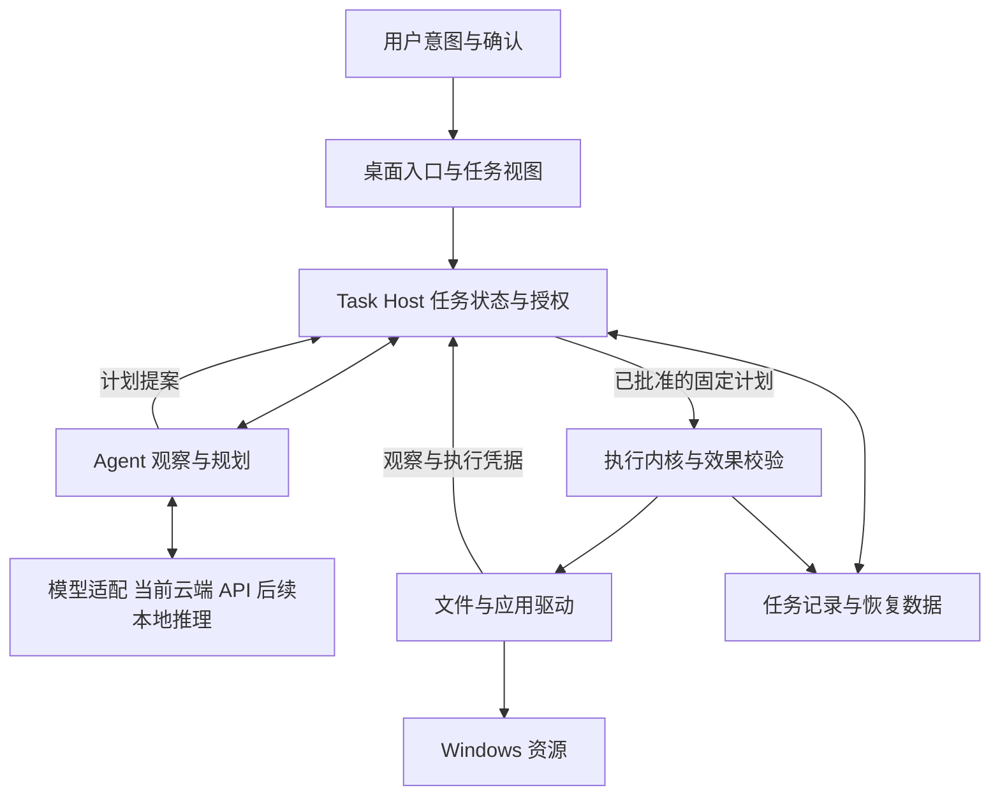

# RFC 0001 — 本地智能体系统技术路线与工程设计

- Status: Draft
- Author: Codex，根据项目维护者确认的产品方向整理
- Created: 2026-10-31
- Protocol: 保留 Action v0；新增任务协议草案，版本独立管理
- Product decision: 第一阶段交付运行在现有 Windows 电脑上的智能体系统；当前国产云端 API 推理，未来适配本地模型

项目方向与决策状态见 [项目总览](../PROJECT.md) 和 [决策记录](../docs/zh-CN/decisions.md)。已确认的语义资源视图、效果凭据与选择性恢复研究方向见 [RFC 0002](0002-semantic-resources-and-effect-receipts.md)；其具体协议与效果仍待原型验证。

## Motivation

deskshell 的长期目标是让个人计算围绕智能体组织：人提出意图，智能体利用电脑完成任务，系统负责管理资源、权限、执行状态和恢复。第一阶段以 Windows 用户态应用交付，复用现有操作系统的进程、设备、文件系统和账户机制。当前接入国产云端模型 API，任务宿主与执行留在本机；本地模型是后续适配方向。专用硬件与系统发行版放在这一形态经过真实使用验证之后。

这一方向需要把现有动作执行内核发展为持续管理任务的运行时。模型理解用户意图并提出方案；授权、任务状态和执行结果由运行时维护。更换模型不会改变这些约束。

### 当前基础与交付边界

| 现有基础 | 可以复用 | 任务层补齐内容，当前状态见下文 |
| --- | --- | --- |
| `packages/core/src/` | Action、策略检查、断言、逆序补偿、JSONL 审计 | 固定计划、可信授权记录、持久任务状态、崩溃恢复 |
| `packages/drivers/` | Windows UIA、平台工厂、MockDriver | 稳定对象身份、统一观察结果、桌面并发规则 |
| `packages/skills/` | 文件整理、归档、窗口操作等技能 | 纯数据调用描述、版本绑定、受限读取、逐项效果声明 |
| `apps/shell/` | Windows 面板、规则意图解析 | 真实模型适配、任务进度与停止、完整失败结果 |
| `packages/mcp/server.ts` | 向外部 agent 暴露本项目能力 | 任务协议入口、可信宿主授权；第三方工具接入另需客户端 |

现有 `run()` 在 preview 和 apply 时都会重新调用 `skill.plan()`。MCP 把技能声明的能力直接作为 granted，Shell 默认也采用这一方式。技能以同进程 TypeScript 动态加载，`SkillContext` 暴露完整 UI driver。因此当前能力检查约束的是经过内核的动作，不能隔离任意技能代码。成功动作在执行后才追加日志，也没有记录“执行中但结果未知”的状态。相关入口见 [kernel](../packages/core/src/kernel.ts)、[MCP server](../packages/mcp/server.ts)、[Shell core](../apps/shell/core.ts)、[类型定义](../packages/core/src/types.ts)。

前一轮修复基线为无桌面回归 52/52、4 项真实桌面检查跳过；G1 首批嵌入式宿主对应 56/56、4 项跳过。后续文件版本已实现隐藏常驻宿主、任务/控制双通道 IPC、全用户持久日预算、照片按月与完整去重待确认、固定恢复预览及进程中断核查。应用版本进一步加入独立记事本任务运行时、持久多轮协调器及服务/CLI 入口；真实模型加合成编辑器三轮通过，固定原生计划另通过完整服务链的 CRLF/LF 验收。本地合成规划与真实 DeepSeek 加原生三轮、四类真机故障及默认生产服务均通过，精确版本/语言配置已放行。新 `agent` CLI 统一到该服务，旧 CLI/Shell/MCP 仍为 v0，原有 [intent.ts](../apps/shell/intent.ts) 仍是规则入口。自由规划、选择性恢复研究及整个 G1–G4 尚未交付；最新证据见 [STATUS](../STATUS.md)，范围见[任务运行时](../docs/zh-CN/task-runtime.md)、[文件任务](../docs/zh-CN/agent-file-task.md)和[多轮任务](../docs/zh-CN/autonomous-tasks.md)。

旧 [milestones.json](../goals/milestones.json) 保留为历史开发记录，新阶段按本文验收：M08 证明意图契约与规则解析，尚未证明真实模型接入；M04 证明录制样本在 Mock 上回放，尚需真实应用回放；M05 尚需补足其原定 UI 技能与快照覆盖；M09 的自动安装测试不能替代外部用户独立完成任务。

## Proposal

### 系统分层



逻辑模块先保持在同一仓库。初期由每用户 Task Host 协调任务，经模型适配器调用云端服务；模型和规划模块不加载驱动。随后把持有驱动能力的执行 broker 与规划 worker 分开部署。未来本地推理服务采用独立生命周期。进程拆分用于生命周期与故障隔离；对第三方不可信代码的安全隔离还需要 OS 级限制，不能以“用了子进程”代替。

| 模块 | 责任 | 依赖边界 |
| --- | --- | --- |
| `packages/core`，现有 | 校验并执行具体动作，验证后置条件，执行补偿 | 不导入模型、桌面 UI 或数据库实现 |
| `packages/runtime`，已有文件宿主 | TaskService、固定计划、逐步检查点和有条件恢复；细粒度资源锁待扩展 | 依赖 core 和独立 TaskStore，未知效果不猜测 |
| `packages/agent`，已有协调器及本地服务 | 本地可信目标、模型提案、常驻 IPC、权限通道与预算连接 | 不自动外发文件树；控制令牌不作为模型工具能力 |
| `packages/models`，已有 DeepSeek 与预算模块 | 受限提案、schema、usage、实例限额、持久 UTC 日预算、超时与取消 | 不持有驱动或授权签发能力；DPAPI 凭据不进入模型上下文 |
| `packages/storage`，TaskStore schema 2 | 计划、批准、执行认领、效果检查点、恢复计划与恢复认领 | 使用 Node 内置 SQLite，v1 保留任务升级；core 不导入数据库 |
| `packages/drivers`，现有 | 文件/窗口/控件的具体操作与观察 | 由执行入口调用，报告实际能力与错误 |
| `apps/runtime`，已有隔离 demo | 提供嵌入式固定计划演示 | demo 的可信调用方持有批准对象；不是产品服务入口 |
| `apps/agent`，已有 CLI 与 daemon | 自动连接或启动隐藏宿主，提供照片任务、历史、停止、恢复、预算和宿主控制 | apply/recovery-apply 绑定精确摘要；status/cancel 可跨进程，不注册开机启动 |
| `apps/shell`、CLI、MCP，现有 | 展示/提交任务、显示差异与结果 | 逐步调用同一个 TaskService，避免三套执行逻辑 |

继续使用 TypeScript 承接运行时与编排，保留 PowerShell UIA 和 Swift AX。只有在 OS 隔离、稳定句柄或测得的性能瓶颈要求下，才引入小范围原生组件。当前 WinForms 面板用于验证流程；桌面 UI 框架的替换以可访问性、安装包、常驻占用的实测为依据。

文件、应用 API、桌面 UI、进程和网络逐步成为并列资源提供者，优先使用可验证的语义接口。provider 描述权限前提、支持的动作版本、恢复级别和取消能力，返回“已执行 / 未执行 / 结果未知”及证据。原有 UiDriver 作为适配层保留；方法存在不等于所有平台拥有相同精度或控件定位语义。

### 当前云端推理与未来本地模型

维护者明确当前使用国产云端大模型 API，长期面向本地模型。首个工程适配目标选 DeepSeek 官方 API 的 `deepseek-flash`；供应商、模型 ID 和能力由配置与适配层管理，core 不依赖具体 API。官方当前提供 JSON 输出与工具调用；应用仍需自行校验 schema、参数和语义。[模型能力与价格](https://api-docs.deepseek.com/quick_start/pricing/)、[工具调用](https://api-docs.deepseek.com/guides/tool_calls)

后续本地适配保留 Ollama 与 llama.cpp server 候选；同一个规划提案与 TaskService 契约跨后端复用。工具调用和结构化输出的协议差异在适配层测试，不把相同 HTTP 形状当作语义完全兼容。[Ollama 结构化输出](https://docs.ollama.com/capabilities/structured-outputs)、[llama.cpp server](https://github.com/ggml-org/llama.cpp/blob/master/tools/server/README.md)

第一版模型输出 `skillId + version + args + goalCriteria`，不生成可执行 JavaScript、PowerShell 或任意 shell。可信技能根据受限观察构造 Action、断言和恢复策略。模型可以提议追问，不能定义“已获用户同意”、伪造回滚能力或凭一句“完成了”结束任务。

云端只承担推理，不启用供应商托管的电脑、文件执行或额外搜索工具。endpoint、模型、凭据引用、可外发数据范围和预算由可信配置管理；文件内容或模型输出不能更改 endpoint。宿主分别核验本地读取权限与向指定供应商发送上下文的范围；只发送任务必要的观察，不把整个桌面、恢复材料或 API key 自动加入请求。密钥留在宿主配置的秘密存储中，不写入仓库、计划、日志或工具参数。具体适配与配置见[模型后端方案](../docs/zh-CN/model-backends.md)。

2026-10-31 的早期接入预验证完成 DPAPI 凭据配置，固定官方端点和非思考模式，发送一次合成请求（778 token）并准备待批准计划。该 greeting demo 的实例限额为 1 次请求、8,192 输入字节、256 输出 token、30 秒和 0.01 USD 估算；它不执行文件，也不代表新的服务默认预算。提案中的目标条件不替代可信验证器，整体 RFC 仍为 Draft。

同日后续照片任务入口使用 512 输出 token 上限，其余单次限制相同。真实请求 862 token，生成 2 次建目录与 3 次移动的计划；独立精确 `apply` 后返回 `succeeded`、目标满足，跨进程读取结果通过。模型只收到用户输入的目标和固定技能说明/schema，不自动收到目录、文件名、hash 或正文；用户写入目标的内容仍会外发。该证据来自隔离合成夹具，不包含用户真实照片、去重或普通撤销，也不使 RFC 整体变为完成。

文件版本服务另外引入跨状态目录共享的全用户持久 UTC 日预算，默认 10 请求/0.10 USD，SQLite 原子预留，未知用量不退款，改额度不清空当天消耗。15:54 的单次真实去重请求使用 1,165 token，7 步执行后目标满足；单独恢复预览及精确批准后，7 个逆向步骤回到 `undone`，完整原始快照摘要相同。宿主停止/重启后任务和已用预算保持。该结果仍限隔离合成文件，未验证真实照片库或 UI 应用。

网络错误、鉴权失败、限流、超时、空白或截断响应均返回明确状态。请求取消后丢弃晚到结果，推理重试不得重复认领执行；供应商可能已产生费用，不能把取消等同于零收费。断网时停止需要新推理的步骤，本地查看记录、停止和有证据的恢复保持可用；已批准的确定性批次按任务既定策略处理，不假装云端模型仍能离线规划。

当前报告记录供应商、endpoint、请求模型与返回标识、思考/采样设置、调用时间、usage、费用估算、有效计划率和目标成功率。无法固定的云端模型版本和硬件如实标注。客户端内存与网络耗时另计；本地模型接入后再测量加载、首 token、RAM/VRAM 和推理吞吐，不把 GPU 配置作为当前云端原型的门槛。模型 confidence 不作为授权依据。

### 观察和任务循环

每次循环为：读取已授权范围内的状态 → 提出下一步或追问 → 生成固定计划 → 校验与必要确认 → 执行一个有界动作批次 → 重新观察 → 检查用户目标。

Observation 至少携带来源、采集时间、对象标识、状态版本、作用域和截断信息。文件先使用元数据及必要内容片段；桌面先使用 UIA 控件树，截图/OCR 在后续作为补充。读取也需要授权。窗口标题只是显示信息，执行标识应逐步绑定进程、窗口实例和控件身份；窗口消失或被替换时重新观察。

网页、文件正文、窗口文本和工具返回都作为外部数据处理，不能修改用户目标或扩大授权。模型上下文与审计日志分开保存；不记录模型内部推理，保存可复核的输入摘要、提案、工具结果和决策理由。

当前记事本多轮实现以受信调用者准备的固定正文与新副本路径为目标，envelope 绑定该计划摘要、资源、能力、输出、轮数和时限。模型每轮仅选择下一阶段 `open/edit/save-copy`，运行时独立核验；一次精确会话批准覆盖这个固定范围，无需每轮重新确认。应用每步先记 intent，再执行和验证；未知效果不自动重放。该实现尚不包含自由目标分解、动态改写正文或新增资源。

记事本会话默认最多 6 轮，可设 3–10 轮，总执行时限 300 秒；云端每请求输入最多 16,384 字节、输出 512 token、超时 30 秒，会话后端实例估算上限 0.05 USD，并受共享持久日预算限制。模型只自动收到用户 intent、阶段观察、上轮阶段反馈和固定 schema；正文、路径、哈希与窗口信息留在本地。intent 中用户主动填写的敏感内容仍会外发。无效提案计入轮数，资源冲突在下一云端请求前停止；具体接口见[多轮任务](../docs/zh-CN/autonomous-tasks.md)。

### 预览和执行同一份计划

`prepare()` 调用一次可信技能并保存规范化后的不可变计划。预览直接渲染该计划；执行只接受其 ID 和摘要，禁止重新调用技能或模型后偷偷替换动作。计划绑定技能版本/内容摘要、输入、目标资源、前置观察版本、动作、效果类型、撤销方式和过期时间。

用户确认后，Task Host 签发只适用于该计划的授权记录。执行前检查计划未变、授权未过期、前置状态仍满足，并取得所需资源锁；内容变化时返回 `STALE_PLAN` 并展示新差异。计划过期、技能升级、作用域扩大、动作增加均需要重新 prepare。人工确认的授权不自动沿用到新摘要；预先配置的委托策略也必须由宿主重新判定并签发新记录。

用户目标摘要、可信验证器的 ID/版本和验收条件也纳入 digest。模型提出的 goalCriteria 只作为候选，不能自行降低原目标。动作全部成功但缺少目标的一部分时，任务仍未完成。每个 planId 只能认领一个执行实例，授权消费与执行认领在同一事务完成；同计划换一个幂等键也不能再次执行。网络重试返回已有 taskId 和状态，确需再做一次则产生新计划与授权。

审批记录存于宿主控制的存储，模型不能签发。MCP 参数中的 `allowIrreversible: true` 只能表示请求，不能在面向普通用户的新入口中直接充当授权证明。MCP 的架构把用户授权和策略职责放在 host；本项目据此把授权入口与模型可调用的工具入口分开。[MCP 架构](https://modelcontextprotocol.io/specification/2026-07-28/architecture)

v0 的 `fs.write` 仍包含多种效果；新任务层按 `read/create/overwrite/move/delete/ui-input/external` 分别登记并限制，防止“整理目录”隐含允许任意删除。文件类原语的后置条件与恢复数据由可信执行端生成和核验。含状态修改的第一方新计划必须有非空后置校验；保留 v0 接口的兼容性不等于允许新入口跳过这条规则。

### 任务状态和恢复

当前文件 TaskStatus 区分 `awaiting_approval`、`ready`、`running`、`cancelling`、`succeeded`、`partial`、`cancelled`、`needs_attention`、`recovering`、`undone` 和 `restored`。`succeeded` 必须有目标验证证据；`partial` 表示部分效果或目标未满足，`needs_attention` 表示冲突、失败或效果未知。恢复状态另存于 TaskResult.recovery，前向结果保留作历史。多轮协调器另存会话、逐轮观察/提案/效果/验证和事件；单轮内嵌 API 可在已验证边界暂停。未来修改目标或扩大资源范围必须产生新的授权对象，不覆盖旧记录。

记事本任务独立保存源文件身份、原字节、编码/换行、完整目标正文、输出路径和 driver session。`advance` 每次一个阶段，保存后独立重读磁盘；`observe` 重新检查真实 UI 与源/副本，历史成功不保证当前仍满足目标。中断、人工编辑、未知保存结果进入 `needs_attention`；现阶段没有应用 Undo 或自动补偿，不能把文件任务恢复直接套用到未保存缓冲区。

输入模式同样纳入计划与观察合同。默认 `foreground` 要求前台，只有受信驱动显式声明 `targeted` 并提供一致证据时才允许定向输入；其观察 token 只忽略焦点变化，仍绑定窗口、活动标签/文档、路径、正文、dirty 与标题。全局键盘备用操作仍须紧邻输入核验前台。现代记事本以明确 Owned Open 建立路径来源，再由连续会话守卫覆盖模型思考及短命 helper 间隙；当前守卫对任何人工输入变化停止，限制仅适用于合作式冲突检测，不是同账户恶意 UIA/SendMessage 的隔离保证。版本化配置记录 raw CR 映射、控件操作和对话框 owner；完整设计与验收分级见[首个应用](../docs/zh-CN/first-application.md#原生适配的确定设计)。

原生发行版配置由服务选择，须同时通过代码内放行门与本地精确版本/语言匹配；当前已放行 `11.2607.14.0/zh-CN`，仅 UTF-8 无 BOM，默认生产服务闭环已复验。通用驱动无 profile 时不启用保存。probe 是元数据/能力查询，`runtimeVerified=false` 不随配置放行改变，配置状态另存 `profileVerified/profileSelection`。生产宿主生命周期内只执行一个文档任务；后续任务在新模型请求或 UI 操作前拒绝，需停止/重启并准备新计划，不自动关闭记事本窗口或复用旧 UI 连续性。

“停止”首先禁止启动下一步，再取消支持取消的推理/读取，并等待正在执行的效果得到结果；随后按该任务策略保留已完成结果或补偿。确认停止之前显示 `cancelling`，不能把进程被杀等同于撤销成功。UI 隐藏和停止任务使用不同操作。

TaskStore schema 2 使用 Node 内置 SQLite 保存 tasks、plans、approvals、claims、effects，以及恢复计划/批准/认领；JSONL 保留审计与旧日志格式。effects 使用 intent、verified 和 not_applied 记录动作与前后快照。当前文件宿主串行执行，后续再引入细粒度资源冲突控制；桌面操作仍以串行为目标。Node 22.23.4 的 SQLite 仍标为实验特性，长期依赖与平台矩阵继续验证。

G1 首批完成宿主和持久认领；文件版本进一步补齐常驻 IPC、步骤核查和固定恢复计划。中断后未完成执行或恢复首先标为需处理，禁止自动重放，核查后由用户重新批准可验证的恢复。G1 的旧入口迁移、G2 的更广泛原语/备份/资源锁及 G4 的启动集成、休眠和桌面体验仍待完成。

SQLite WAL 可支持本机读写并行；数据库放在本地磁盘，并明确配置持久化、checkpoint 与备份策略。它不适合把同一 WAL 数据库放到网络共享供多机访问。[SQLite WAL](https://sqlite.org/wal.html) 绑定库/Node 版本通过兼容矩阵后再固定，引入依赖按 RFC 流程处理，core 不直接依赖数据库。

当前每一步先持久化 intent、动作和完整前置快照，提交后再次核验完整树及紧邻使用的对象，再启动效果；验证后保存 verified 快照。未知对象身份拒绝猜归属。尚未支持文件覆盖；后续引入覆盖时，原始字节备份必须先持久化，再写入可引用它的记录。UI 只能声明能够验证的补偿能力。

数据库提交与文件/窗口副作用不构成共同的原子事务。若进程在动作完成后、记录写入前崩溃，重启必须将该步视为 `uncertain`：重新观察，对已登记的幂等操作决定补记或恢复；不能判定时进入 `needs_attention`。不能盲目重放点击、发送或覆盖，也不能承诺任意动作 exactly-once。

恢复与普通撤销都检查当前对象身份/内容；他人修改导致冲突时保留现场并说明。SQLite 负责记录一致性，恢复正确性仍由原语与故障测试证明。跨文件、应用和外部工具的工作流只提供明确的补偿边界，不宣称整台电脑事务原子化。

当前恢复以整个有界文件树为冲突单位，支持移动逆转、移除已验证的新文件和空的新目录。未落盘验证身份的新对象、额外文件或人工修改导致拒绝，尚不做选择性合并。恢复中断同样保存 intent/verified；新预览只包含可核验的剩余逆步骤。13 组检查覆盖真实进程退出及持久化窗口冲突，未验证断电或原生对象句柄级隔离。详见[恢复实现](../docs/zh-CN/task-recovery.md)。

效果分别标为可精确恢复、可补偿、不可逆；结果未知是另一条状态维度。发送、发布等不可逆能力可以在后续按明确确认与回执契约加入。长期承诺是批准对象明确、结果可核查、恢复边界可见，而非每个动作都能撤销。

### 权限边界和扩展代码

初期桌面产品只加载审阅过的第一方技能。现有 `deskshell add` 的任意 TypeScript 路径保留为开发者受信执行方式，不能无提示地混入普通用户的模型工具目录。运行时需把 SkillContext 拆成只读的 ObservationProvider 与只供执行端使用的 Driver，逐步去掉计划阶段直接调用写接口的可能。

Node Permission Model 用于减少受信代码误操作，官方明确不把它视为恶意代码的安全边界。`worker_threads`、独立进程和禁用若干 import 同样不能单独证明第三方代码已被隔离。[Node 权限模型](https://nodejs.org/api/permissions.html)

第三方扩展阶段再引入 OS 沙箱与窄接口 broker。Windows 可研究 AppContainer 的文件、网络和进程限制；与 Node/模型服务的兼容性需要原型验证。[AppContainer](https://learn.microsoft.com/en-us/windows/win32/secauthz/appcontainer-isolation) broker 留在用户交互会话内，使用普通用户权限，负责必要的桌面操作；不让沙箱 worker 直接操纵其他窗口。

常驻宿主采用每用户进程，本地 IPC 使用会话身份和 ACL 校验；不用一个 LocalSystem 后台服务直接控制用户桌面。Windows 服务与交互会话存在明确边界，官方建议通过用户会话进程和 IPC 交互。[Windows 交互服务](https://learn.microsoft.com/en-us/windows/win32/services/interactive-services)

当前实现为隐藏的普通用户子进程，只监听 127.0.0.1 随机端口，私有状态目录保存端点及任务/控制 bearer token。Windows 用当前账户 DACL，其他受支持平台使用私有目录权限；误配目录在改 ACL 前拒绝。任务通道不能签发执行或恢复批准、更改预算；控制令牌不交给模型。此边界不隔离同账户任意恶意代码，没有注册开机启动或 LocalSystem 服务。

同一账户身份不等于审批权限。approve 仅能由可信 UI 的专用确认通道进入，宿主关联具体待批准计划和一次性确认请求；普通任务/MCP/模型工具通道不能路由到它。不能凭请求中的 clientType 或 UserDecision 自报字段取得审批身份。审批通道能力不交给规划 worker；对已完全控制同一用户账户的恶意进程，须另行界定 OS 隔离边界。

路径与对象检查在动作执行及补偿前都做。需要抵御敌对并发替换时，应通过原生句柄和对象身份约束关闭检查到使用的竞态；在该能力验证前，不对不受信文件树或任意本地恶意进程作隔离保证。任务存储和凭据目录不作为可操作工作目录暴露给模型。

GUI 输入也可能间接触发应用联网或访问文件。禁止 planner 联网不代表它通过浏览器或其他应用无法外发数据；应用目标、控件操作与外部提交需要各自的策略边界，不能把 ui.input 当作低风险的通用权限。

### 记忆和工具生态

先保存任务历史、用户明确确认的偏好、具备来源/时效的任务摘要。观察缓存短期有效；记忆不是授权，删除偏好不等于撤销历史外部效果。检索先使用结构化字段和全文查询，需要语义检索的实测场景出现后再引入向量索引。全盘索引、无限截图留存不进入首个交付。

MCP server 继续供其他 agent 使用。自有 agent 调用第三方 MCP 工具需要独立 client、注册表、参数校验、权限与副作用映射。工具提供的 read-only、幂等或可撤销标签只作为声明，不能作为证明；先接一个明确只读的本地工具，再考虑带副作用的外部集成。任何外部确认结果都绑定具体目标、参数与有效期。

### 分阶段技术路线

以下为验收顺序，不是日历工期。真实云端 API 的只读适配实验可以与 G1 并行；模型触发写入必须等待固定计划和授权链路完成。

| 阶段 | 交付物 | 进入下一阶段的门槛 |
| --- | --- | --- |
| G1 固定计划与统一入口 | 最小单用户宿主、TaskStore 计划/授权/执行登记、PreparedPlan、三入口共用 TaskService | 预览后修改文件/参数/技能版本会失效；同计划并发、完成后和重启后重试不重复执行；模型无法伪造批准；Shell 返回真实结果 |
| G2 步骤持久化与恢复 | 步骤事件、原始数据备份、资源锁、恢复检查、停止状态 | 在每个持久化/执行边界杀进程，重启后每步可定位为未执行/已验证/需处理；不静默重放；外部修改不被覆盖 |
| G3 智能体闭环 | 一个真实云端模型适配器、限定技能规划、观察验证、追问与调用预算 | 无规则触发词的任务表述仍可完成；无效输出无副作用；断网明确暂停新推理，本地记录/停止/恢复可用；不越权或重复执行 |
| G4 常驻桌面产品 | 用户会话宿主、热键面板、进度/历史/恢复视图、记事本文档场景 | 冷启动/休眠/窗口重建/人工抢焦点下状态可解释；记事本版本、语言与 DPI 实测；陌生用户独立完成三类任务 |
| G5 扩展与设备演进 | 第三方隔离、MCP client、跨平台适配、设备配置基线 | 沙箱逃逸/越权测试与工具副作用契约通过；再决定是否交付专用设备或 Linux 系统形态 |

第一阶段面向用户的产品验收由 G1–G4 共同构成。各门槛通过前，接口或测试数量不能单独代替产品完成。

研究原型与工程阶段并行：G1 可开展只读的任务相关语义视图实验；模型触发写入须经过固定计划与可信授权。效果凭据和选择性恢复与 G2 的步骤记录协同，G3 先以相同云端服务与模型配置、底层操作、授权和预算验证收益，后续在本地模型复验。云端硬件不可控，不能由相同客户端硬件推断推理条件完全一致。研究方向已确认不表示新 schema 已冻结，也不改变 Action v0 的兼容语义；详见 RFC 0002。

### 第一条垂直场景

用户选择一个目录并说“把里面的照片按月份整理，重复内容放到待确认目录，保留其它文件”。先授权读取，模型生成技能和参数提案；缺少日期依据或意图含糊时追问。可信技能准备具体文件清单和差异，用户确认后执行同一计划，重读验证，返回可撤销的 taskId。

第一版以文件技能验证完整链路，模型不直接编写搬移命令。若现有 photo-sort 与去重技能组合不足，明确新增一个受信组合技能，不把业务逻辑塞进模型提示词。测试包含同名冲突、人工修改、磁盘写入失败、取消、进程中断和恶意文件正文中的指令。

验收必须明确月份来源、时区、重复内容的判据与保留规则。现有 photo-sort 使用文件修改时间；dedupe-folders 对大于 8 MiB 的文件只比较前缀指纹与大小，并使用 `.trash` 作为目标目录，不能直接视为上述新场景已达标。新路径需核验完整内容，将具体移动集合、保留集合和内容一致性交给可信目标验证器检查。

当前[照片任务技能](../packages/runtime/src/photo-task.ts) 限定根层图像扩展名文件，固定 `mtime`、`Asia/Shanghai`；显式去重将完整内容相同的副本移至 `_duplicates`，按 UTF-16 区分大小写文件名排序保留第一份。已有目录可复用、同名冲突拒绝，其他文件保留。目标由原始有界树独立生成，验证完整集合、字节、修改时间和身份，不从模型或动作反推成功。新 `agent` CLI 已提供批准、历史、跨进程停止及固定恢复预览；多轮澄清和更大规模任务仍待验证。

应用场景已实现受限记事本状态机和三轮适配器：打开已知测试文档、输入固定正文、另存新副本、重读核验。真实 DeepSeek 配合合成编辑器三轮通过，2,696 token、估算 0.0038343 USD（非账单），与原生 UI 证据分开登记。2026-10-31 在 `11.2607.14.0` 的独立测试窗口完成早期截图引导冒烟，合成副本 178 字节、UTF-8 无 BOM、CRLF，原文保留；当时 Computer Use 的 accessibility 为 null，后续原生 UIA 已确认完整 TextPattern/ValuePattern 可读，因此这是工具读取缺口。

经授权的后续原生实验确认同 PID 多窗口、raw CR 表示、产生 dirty 状态的定向编辑，以及文件名控件需要正确通知应用内部模型；另存原语已产生 145 字节精确副本且源文件未变。随后固定计划通过真实服务 IPC、应用宿主、候选原生驱动和持续守卫，CRLF/LF 两次均 succeeded；三个阶段都有 verified/native-window/targeted 证据，中文路径与标题修改、追加、空行、UTF-8 无 BOM、精确副本、源文保持和仅新增预期文件均验证。

早期原生多轮尝试两次因 `GUARD_INPUT_CHANGED` 停止，保留为拒绝记录。随后本地合成规划和真实 DeepSeek 加原生均在完整 IPC 链完成三轮；真实原生三轮为 843/890/810 token，合计 2,543，保守估算 0.0038316 USD（非账单）。缓冲修改、未授权对话框、显式驱动关闭、守卫进程中断四类真机故障均保留源文且无输出，缓冲修改保留人工内容；只终止专用 monitor，未终止记事本。默认服务选择已放行配置后也成功，第二文档任务在新输入前拒绝。拒绝与完成分开计数；同名同字节切换、人工另存、冲突与中断继续纳入后续矩阵。[首个应用](../docs/zh-CN/first-application.md)分别登记截图、原生原语、合成驱动、多轮模型及固定原生完整链证据。

## Protocol diff

保留现有 Action v0、Skill v0 和旧 CLI/MCP 工具，不直接改冻结清单。以下节选当前文件宿主契约，完整类型以 [runtime/types.ts](../packages/runtime/src/types.ts) 为准；应用任务合同见 [notepad-task.ts](../packages/runtime/src/notepad-task.ts)，固定授权多轮合同见 [autonomy.ts](../packages/agent/src/autonomy.ts)。跨资源动态修订及通用 UI 原语仍属于草案：

```ts
interface PreparedPlan {
  formatVersion: 1;
  actionProtocol: "v0";
  taskId: string;
  planId: string;
  digest: string;
  skill: { id: string; version: string; contentHash: string };
  root: string;
  input: Record<string, JsonValue>;
  goal: { intent: string; criteria: JsonValue; validatorId: string; validatorVersion: string };
  granted: CapabilityId[];
  observation: TreeSnapshot;
  actions: readonly Action[];
  expiresAt: number;
}

interface TaskService {
  prepare(request: TaskRequest): Promise<PreparedPlan>;
  inspect(planId: string): PreparedPlan;
  execute(request: {
    planId: string;
    digest: string;
    approvalReceiptId: string;
    idempotencyKey: string;
  }): Promise<TaskResult>;
  cancel(taskId: string): TaskResult;
  get(taskId: string): TaskResult;
  list(): TaskResult[];
  prepareRecovery(taskId: string): Promise<RecoveryPlan>;
  inspectRecovery(recoveryId: string): RecoveryPlan;
  recover(request: { recoveryId: string; digest: string; approvalReceiptId: string }): Promise<TaskResult>;
}

// approve 属于可信宿主 IPC，不能注册成模型可自行调用的工具。
interface ApprovalAuthority {
  approve(planId: string, digest: string): ApprovalReceipt;
  approveRecovery(recoveryId: string, digest: string): RecoveryApprovalReceipt;
}
```

`TaskRequest`、`TaskResult`、授权及观察结构必须有运行时 schema、状态迁移规则和错误码。digest 由可信端规范化后计算；字符串摘要不代替授权记录和对象状态检查。当前按固定 planId/recoveryId 唯一认领，执行请求中的 idempotencyKey 只作关联；不能凭相同键把不确定效果假定为已执行一次。更广泛的调用者幂等范围随入口迁移继续定义。

RecoveryPlan 绑定 taskId、原 planId、恢复模式、当前及原始完整快照、证据链摘要、逆向步骤、权限和有效期。正常成功任务使用 `undo` 模式，部分或中断任务使用 `restore` 模式；两者都必须先核查，再单独批准。取消只阻止下一步，不隐含批准恢复。原型幂等由 planId/recoveryId 的持久唯一认领保证，未知效果不自动续跑；跨入口迁移待决项见 Q08。

新 MCP prepare/inspect/execute 工具按新名字并行引入，execute 不再接收可以改变原计划的 skill/args。旧 `deskshell_apply` 继续作为明确标注的受信开发者接口；普通用户产品不把这一入口暴露给模型。MCP 传输协议版本兼容另做客户端矩阵，不能因存在 JSON-RPC 测试就宣称支持任意版本。

## Migration

1. 先抽出统一入口，保留 v0 `run()` 的兼容行为；新的固定计划路径与旧行为使用独立测试。迁移 CLI/Shell/MCP 时逐个切换，避免预览和执行跨路径。
2. 第一方技能迁移到受限观察接口并补齐有效后置校验、恢复材料和版本清单。旧 TypeScript 技能保留受信模式，不自动获得沙箱认证。
3. 旧 JSONL 以 legacy 来源导入或只读展示，保持 taskId/状态；没有执行中记录、备份或授权凭据的历史任务不得自动推断为可崩溃恢复。导入记录源文件摘要，重复导入不重复创建步骤。
4. 新任务数据库放在宿主私有数据目录；迁移前备份，保留旧文件。跨版本升级时先检查 schema 版本，不能由旧程序忽略新任务状态继续写入。
5. `goals/milestones.json` 作为旧记录保留；产品验收采用本 RFC 门槛。旧 `clock.ts` 仍按该文件的 done 统计，后续迁移必须将输出标为旧计划，不能把它当新产品进度；新阶段另设与证据绑定的状态来源。

## Regression evidence

当前实现与后续验收分开。G1 首批无桌面回归为 56/56、4 项跳过，初始照片闭环批次为 59/59、4 项跳过。后续文件版已有照片 26 组、预算 23 组、恢复 13 组、服务 IPC 13 组、CLI 9 组，宿主 19/19 和智能体集成 12 组分别验证。真实模型、进程故障注入、Mock 和真实桌面证据分开记录；最新完整回归见 [STATUS](../STATUS.md)，接口限制见[运行时](../docs/zh-CN/task-runtime.md)和[恢复说明](../docs/zh-CN/task-recovery.md)。本 RFC 总体仍未完成。

G1 首批实现按五个可独立评审的变更交付：TaskService、完整 TaskResult 和最小单用户宿主；TaskStore 最小持久记录及固定计划摘要；宿主授权与执行认领；执行同一计划、失效检查与取消边界；三入口迁移及集成验收。候选新增检查如下，命令名是待实现约定：

| 验收 | 必须观察到的行为 |
| --- | --- |
| `prepared-plan-test.ts` | prepare 只规划一次；execute 不再调 plan；修改摘要/输入/技能版本拒绝；过期或资源变化返回明确失效；漏满足用户目标不能标 succeeded |
| `approval-boundary-test.ts` | 没有宿主授权、伪造批准身份、跨计划重放授权、扩大效果范围、模型自行传确认开关均不能执行；同计划正常重试返回已有任务 |
| `task-claim-test.ts` | 两客户端并发、完成后重试、重启后重试及更换幂等键均不能重复认领同计划；中断任务未经核查不能再次执行 |
| `task-entrypoints-test.ts` | CLI、Shell、MCP 对同一计划给出一致 taskId、执行与恢复结果；Shell 不再把失败包装为 ok |
| `task-recovery-test.ts`，已实现文件子集 | 13 组：移动前后及恢复边界杀进程、未知新对象拒绝、人工冲突和持久化窗口保护；不代表任意原语或断电验收 |
| `model-backend-eval.ts`，G3 | 真实云端请求、留出任务、无效结构/幻觉工具/提示注入、预算、限流/超时/断网及取消；本地后端后来单列复验 |

评估集版本化，分别报告计划合规率、目标成功、越权阻断、恢复、残留、误报完成、取消响应、API usage/费用和客户端资源。安全与记账不变量的已定义测试必须全部通过；质量和性能阈值在服务配置与测试集确定后公布。本地推理的 RAM/VRAM 后续单列，不把拒绝、Mock 和真实应用成功合成一个百分比。

## Alternatives

1. 立即做自有内核或 Linux 发行版：暂不采用。当前最需验证的是任务、模型与资源的协作契约；底层设备管理已有宿主 OS 承担。保留未来专用设备的接口边界。
2. 模型直接生成命令并操作系统：不采用。难以绑定预览、权限、观察与恢复，错误命令会越过已有内核。
3. 全部改写 Rust 并重做桌面 UI：暂不采用。当前问题主要是系统语义与状态管理；原生代码优先用于明确的隔离或句柄能力缺口。
4. 先发布任意第三方技能市场：不采用。动态代码目前具有宿主权限，能力声明无法替代代码隔离。先完成第一方使用路径。
5. 只继续提供 MCP 工具：保留为开发者入口，但无法独立提供用户选择的本地智能体产品，还需要任务宿主、推理与桌面交互。

## Rollback

新服务通过独立 agent 入口引入，没有切换旧 CLI/Shell/MCP。出现问题时停止接受新任务，等待已开始效果得到结果或标记需处理，再停止宿主。未知效果不能自动退回旧执行器继续跑。新宿主的 `rollbackOnFailure: false` 保留失败现场，只有经过证据核查、固定预览和精确批准的恢复才可继续；不调用旧逆动作宣称自动恢复。

任务数据库先备份，迁移可导出原始事件。旧版本不理解的新状态保持只读，由支持该状态的恢复工具处理；回滚应用版本不等于撤销用户任务。模型适配器可单独关闭，确定性技能入口继续工作。

## History

- 2026-10-31：根据维护者选择“现有电脑上的本地智能体系统”创建 Draft；记录技术路线、任务协议草案与分阶段验收。产品方向已确认，详细协议待评审和实现。
- 2026-10-31：维护者同意两项技术研究方向并要求归档，补充项目总览、决策记录及 RFC 0002 的关联；本 RFC 具体接口保持 Draft。
- 2026-10-31：维护者澄清当前使用国产云端大模型 API、长期面向本地模型，并委托选择应用。当前默认 DeepSeek 官方 API，首个真实应用选 Windows 记事本；调整模型、断网和实验验收，接口继续保持 Draft。
- 2026-10-31：维护者同意继续后，交付 G1 首批嵌入式文件任务原型，采用 Node 内置 SQLite；固定动作控制、独立批准、唯一认领和保留现场策略已实测。总体 RFC 仍为 Draft，未将三入口迁移、可信 IPC 或 G2 恢复记为完成。
- 2026-10-31：接入 DeepSeek 官方受限提案适配器与 Windows DPAPI 凭据入口，17 组离线检查及一次真实合成提案到固定计划预览通过。G3 完整任务循环、持久每日额度与真实应用验收仍待实现。
- 2026-10-31：新增仓库内 `agent` CLI、照片任务协调器和独立目标验证器，在合成夹具上完成真实模型提案、单独精确批准、5 步执行、结果验证与跨进程状态读取。支持动作边界停止；旧三入口迁移、可信 IPC、去重、普通撤销及完整 G1/G3 尚未完成。
- 2026-10-31：按版本级目标加入隐藏常驻宿主、双通道 IPC、共享持久 UTC 日预算、完整内容去重待确认和固定恢复协议。真实合成任务 7 步执行与 7 步逆向恢复均核验，宿主重启保留任务与预算；旧三入口、多轮规划、真实应用及选择性恢复研究仍待推进。
- 2026-10-31：增加独立记事本任务状态机、固定授权多轮协调器及 CLI/服务入口，离线验证逐轮观察、阶段选择和独立目标检查。真实记事本截图引导冒烟另存成功，但 accessibility 为 null；原生产品驱动默认拒绝未验证的另存配置，真实自主 UI 与应用恢复仍未完成。
- 2026-10-31：后续专用窗口原生验证确认 TextPattern/ValuePattern 可读、定向编辑与文件名通知路径可用，得到 145 字节精确副本且源文保留。输入模式绑定计划，版本化控件适配和连续会话守卫整合中；这些原语结果尚不等于产品端到端验收。
- 2026-10-31：固定原生计划通过服务 IPC/应用宿主/驱动完整链，CRLF/LF 两次成功，三阶段机器证据及独立字节目标均验证。原生多轮人工输入拒绝另计，云端原生与故障矩阵继续推进；增加精确发行版配置选择与每宿主生命周期一个文档任务的明确边界，生产放行门尚未开启。

- 2026-10-31：原生合成规划和真实 DeepSeek 均完成三轮，四类真机故障保护通过。精确 11.2607.14.0/zh-CN 配置已放行，默认生产服务另行验证完整固定任务和第二文档任务拒绝；任意应用规划、更多扰动及应用恢复仍待推进。
